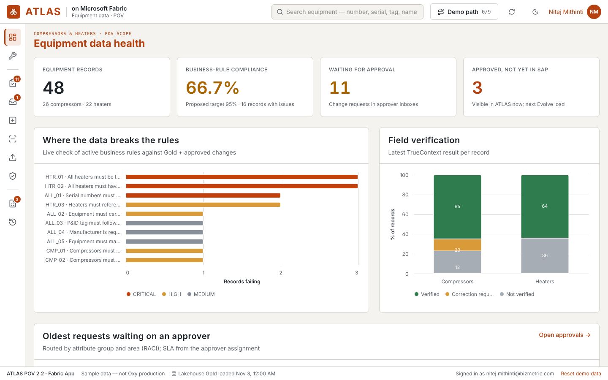
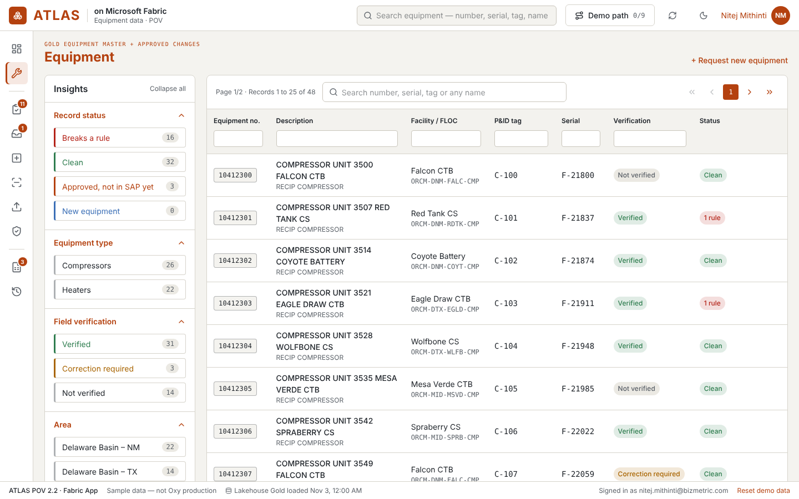
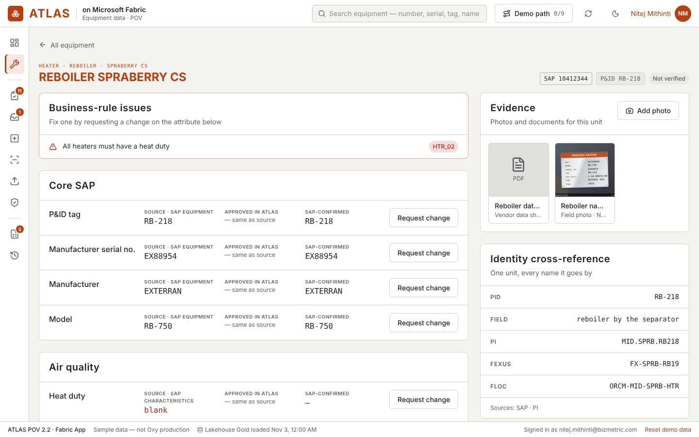
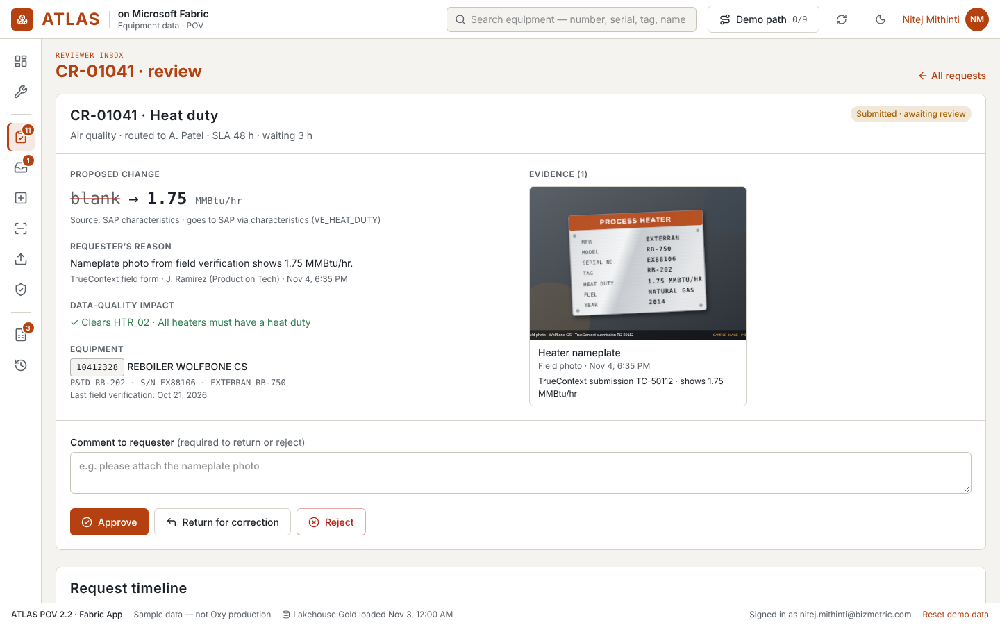
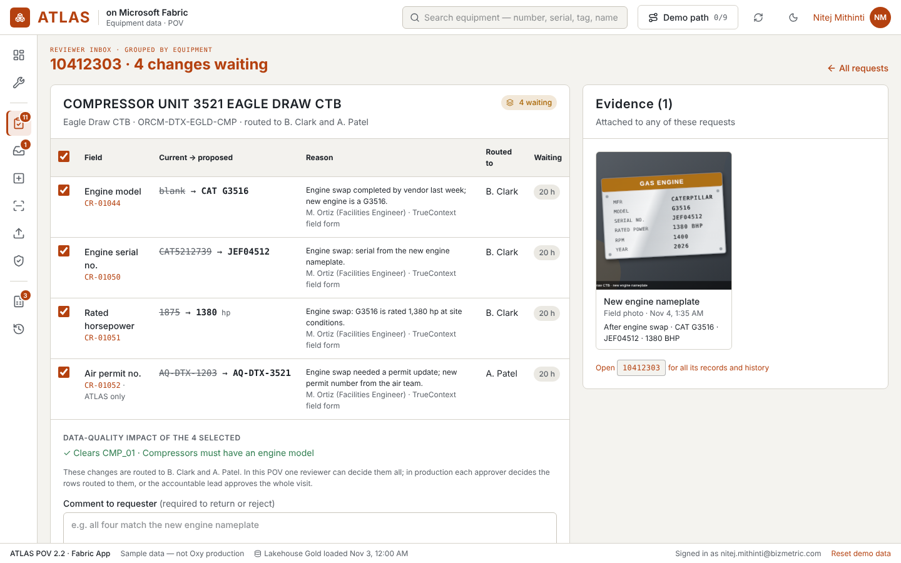
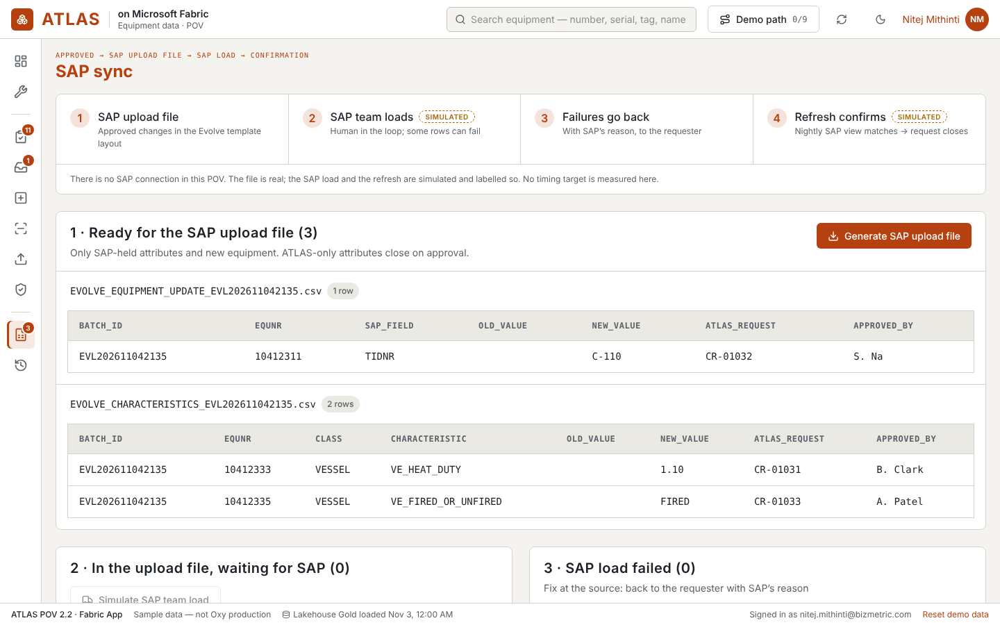
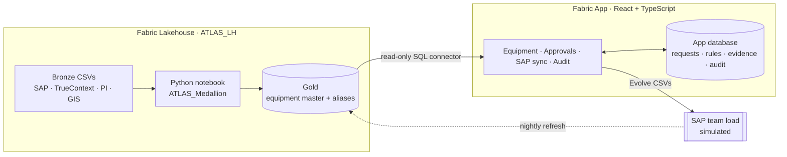

# ATLAS — Equipment Data Governance on Microsoft Fabric

**A governed workflow for keeping equipment master data correct: find the problem, fix it with evidence, route it to the right approver, and hand it to SAP with a full audit trail.**

Built as a proof of value (PoV) for an oil and gas operator's equipment-management workshop. It runs as a native **Microsoft Fabric App**, on React, TypeScript and a Fabric Lakehouse.



> **Note:** all data in this repository is **synthetic**. It is shaped like real compressor and heater records but contains no production data. There is no live SAP connection. Steps that stand in for SAP or AI are clearly labelled **SIMULATED** in the app.

---

## The problem

Equipment data such as compressors and heaters is spread across SAP, field forms and spreadsheets:

- **No common identifier.** The same unit goes by many names: SAP number, P&ID tag, PI tag and more.
- **Missing attributes.** Emissions and air-permit reporting depend on fields SAP often doesn't hold, such as heat duty and fired or unfired status.
- **No rules at entry.** Errors are found late, by hand.
- **Slow, untraceable fixes.** Approvers chase evidence across systems, and nobody can see what changed or why.

## What ATLAS does

| Step | In the app |
|---|---|
| **Find** | Search any identifier (SAP number, serial, P&ID tag, nickname). Live business rules flag every record that breaks a rule. |
| **Fix with evidence** | Propose a change from the record itself, with nameplate photos or data sheets attached. Works on an iPad, where the camera can be used. |
| **Route** | Each request goes automatically to the right approver by **attribute group × area**, with a delegate and an SLA. |
| **Decide fast** | The approver sees the proposed value, the evidence and the **data-quality impact** side by side. Related changes on one unit can be **reviewed and approved together**. |
| **Use it now** | Approved values show up straight away. Each field shows its *source*, *approved in ATLAS* and *SAP-confirmed* values. |
| **Publish to SAP** | Generates SAP upload files in the Evolve loader layout. SAP load failures go back to the requester with SAP's reason. A reconciliation step closes each request. |
| **Prove it** | Every action has a request timeline and an append-only audit history. |

### Screens

<table>
<tr>
<td width="50%"><br/><b>Equipment.</b> Insights facets with counts, plus per-column filters.</td>
<td width="50%"><br/><b>Equipment record.</b> Rule issues, the value trail, evidence and identity cross-reference.</td>
</tr>
<tr>
<td><br/><b>Approval review.</b> Evidence beside the change, with the rule impact and timeline.</td>
<td><br/><b>One field visit, one approval.</b> All changes on a unit decided together.</td>
</tr>
<tr>
<td colspan="2"><br/><b>SAP sync.</b> Upload file, then SAP load, then failures back to the requester, then reconciliation.</td>
</tr>
</table>

**Also included:**

- **New equipment** with a duplicate check (serial and tag matching, with O/0 and dash normalisation).
- **Bulk upload** from a pre-filled CSV template, with row-by-row validation.
- **Data quality**, where business rules are stored as data and can be switched on or off without a release.
- **EquipmentIQ**, a labelled, simulated scenario showing an AI nameplate reader feeding human review.

---

## Architecture



- **Gold is read-only.** Approved changes are overlaid on Gold in the app, so users see them before SAP is updated, and rejected or failed SAP loads never leak into the view.
- **SAP stays the system of record.** ATLAS-only attributes (for example air permit number) close on approval; SAP-held ones go through the upload file.
- **No separate server.** Hosting, Entra ID sign-in and storage are all provided by Fabric.

## Tech stack

| Layer | Technology |
|---|---|
| Frontend | React 19, TypeScript, Vite, Tailwind CSS v4, lucide icons |
| App backend | Microsoft Fabric Apps (Rayfin): typed data entities, Entra ID auth, hosted static site |
| Data | Fabric Lakehouse (Delta), SQL analytics endpoint connector |
| Pipeline | Python notebook (pandas → Delta) for Bronze → Gold |
| Provisioning | Node.js script using the Fabric REST and OneLake APIs |
| Quality | Vitest unit and component tests, ESLint, Playwright visual checks |

## Project structure

```text
├── packages/
│   ├── frontend/              # React app (src/atlas/ holds the ATLAS screens and logic)
│   │   ├── src/atlas/pages/   # Overview, Equipment, Approvals, UnitReview, SapSync, …
│   │   ├── src/atlas/rules.ts # Business-rule engine
│   │   ├── src/atlas/evolve.ts# SAP upload file builder
│   │   └── .harness/          # Offline demo with an in-memory client
│   ├── data/                  # App-owned entities (ChangeRequest, BusinessRule, Evidence, AuditEvent, …)
│   └── shared/                # Browser-safe shared types
├── lakehouse/                 # Synthetic Bronze data, medallion notebook, provisioning script
├── rayfin/                    # Fabric App configuration and Lakehouse connector
├── docs/screenshots/
├── DEMO-SCRIPT.md             # 15-minute walkthrough
└── DEMO-SETUP.md              # Environment setup
```

## Run it

**Offline demo (no Fabric needed):** this uses the same UI with synthetic in-memory data.

```bash
npm install          # npm 11+ (or: npx npm@11 install)
npm run demo:offline # opens http://localhost:5199/harness.html
```

**Checks:**

```bash
npm run typecheck && npm run lint && npm test
```

**Deploy to your own Fabric workspace:** see [DEMO-SETUP.md](DEMO-SETUP.md). In outline:

1. Provision the Lakehouse with `node lakehouse/provision.mjs`.
2. Point `rayfin/rayfin.yml` at your workspace.
3. Run `npx rayfin up`.

## Scope and honesty

- **Real:** the Fabric Lakehouse, the medallion pipeline, the app, routing, rules, evidence, audit and the generated SAP upload files.
- **Simulated (and labelled in the app):**
  - The SAP team load and the nightly SAP refresh.
  - The EquipmentIQ nameplate extraction.
- **Proof-of-value simplifications:** every signed-in user can act in every role so the full flow can be demonstrated. In production, roles would come from Entra ID security groups.
- **Roadmap ideas:**
  - Email notifications and subscriptions
  - A dedicated field-verification view
  - Marking values as verified without raising a change
  - User area preferences
  - Rule versioning
  - Equipment moves and swaps
  - Databricks portability

## Author

**Nitej Mithinti**, Bizmetric. [github.com/mmithint](https://github.com/mmithint)

Built on Microsoft's Fabric Apps universal template. Template documentation is in [docs/RAYFIN-TEMPLATE.md](docs/RAYFIN-TEMPLATE.md), and template files are under the [MIT License](LICENSE).
